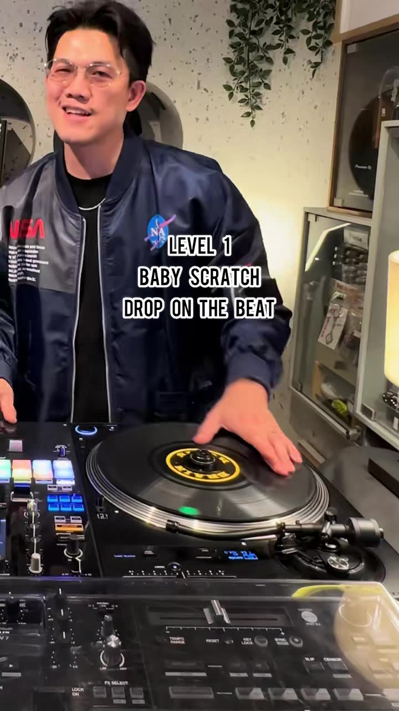
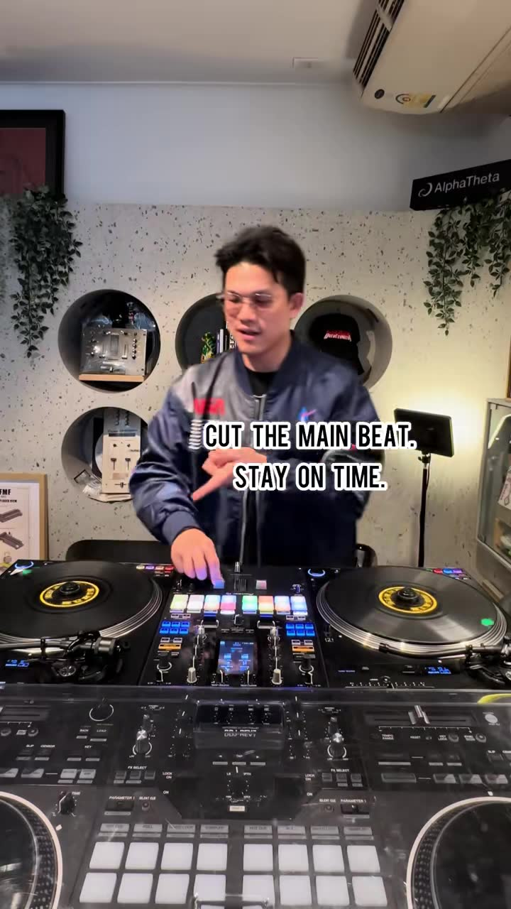
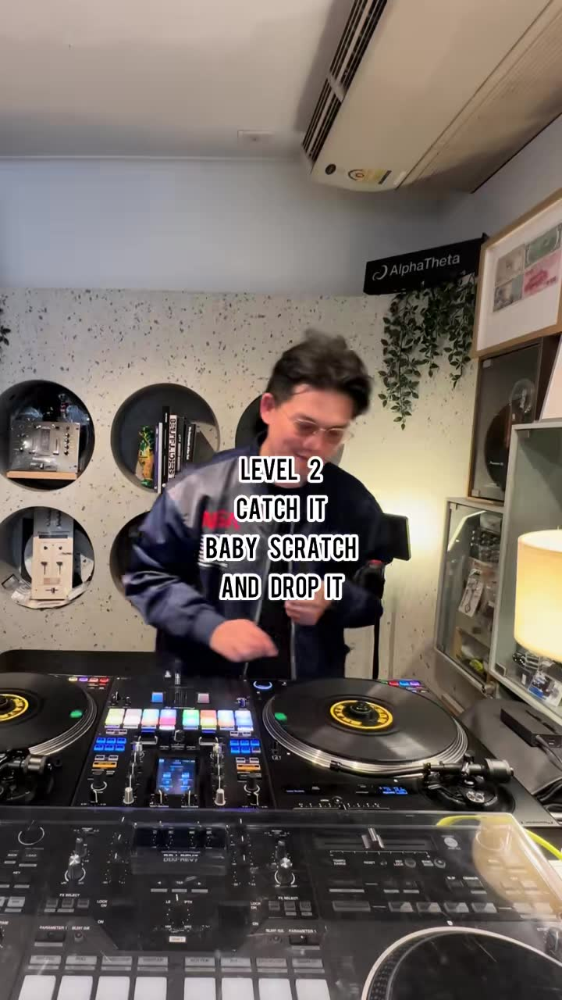
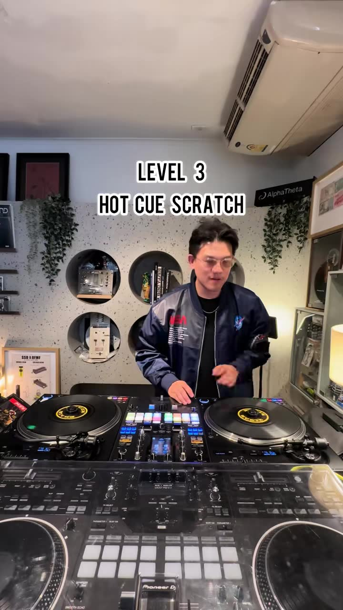
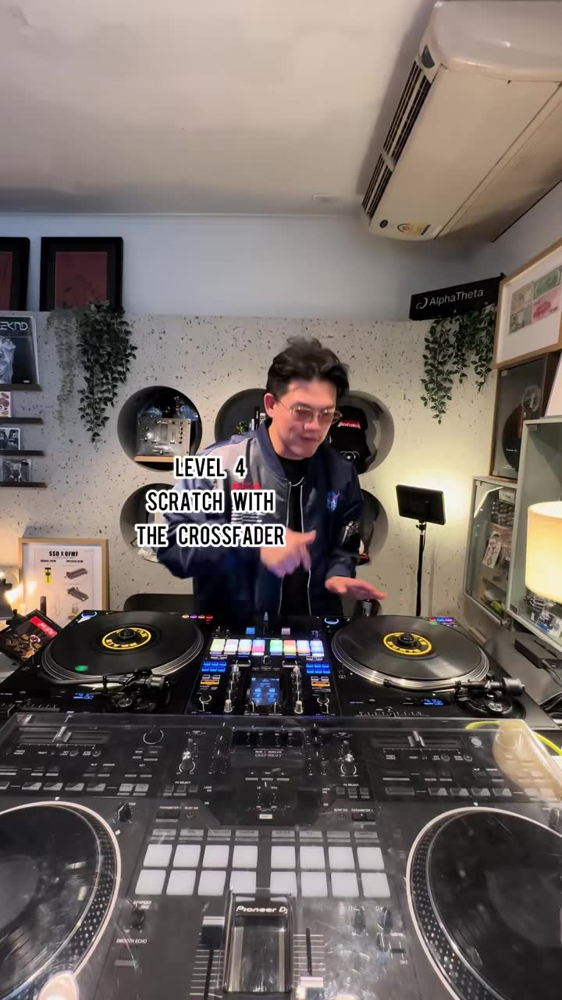
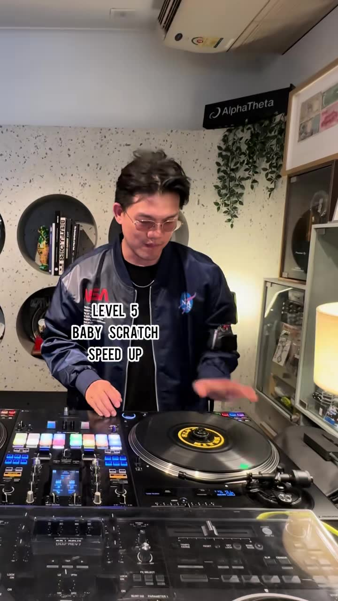
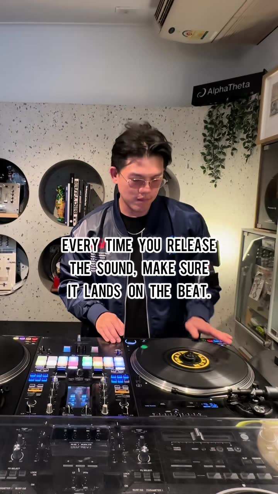
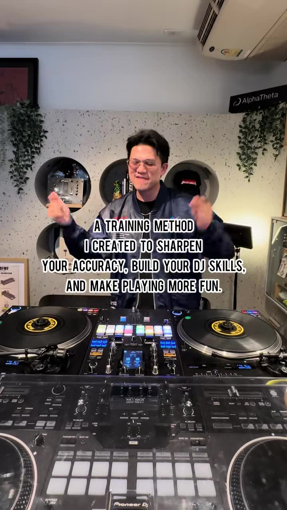

# 1-minute daily scratch training ladder (5 levels)

| | |
|---|---|
| Source | <https://www.tiktok.com/@djaystayhigh/video/7692047131015777550> |
| Creator | DJSTAYHIGH (@djaystayhigh) |
| Uploaded | 2026-10-02 |
| Duration | 43s |
| Hashtags | #dj #howtodj #scratch #djlesson #djacademy |
| Audio | original sound - DJSTAYHIGH |
| Ingested | 2026-10-30 by yeung-assistant (yt-dlp + faster-whisper `small`, language `nn`) |

**Caption (verbatim):**

> 1 minute every day Training 🥷🏼 #dj #howtodj #scratch #djlesson #djacademy

## Summary

DJ Stayhigh shows a short daily drill with five levels of scratching over a beat: a baby scratch dropped on the beat, catch-and-drop, a hot-cue scratch, scratching with the crossfader, and a sped-up baby scratch. The core rule is to cut the main beat, stay on time, and make sure every release lands on the beat. There is no speech (music only), so the instructions are on-screen text.

## Key takeaways

- Level 1: baby scratch, then drop on the beat.
- Cut the main beat and stay on time (the scratch replaces the beat; timing is everything).
- Level 2: catch it (stop the record), baby scratch, and drop it.
- Level 3: hot cue scratch (trigger a hot cue, then scratch from it).
- Level 4: scratch with the crossfader (forward scratch, gating the sound with the fader).
- Level 5: baby scratch, sped up.
- Train your ears: every time you release the sound, make sure it lands on the beat.

## Verbatim phrases and script

No speech was detected (the whisper language ID guessed "nn"/no language over the music). Every instruction is on-screen text, quoted under "On-screen text".
> Caption: "1 minute every day Training #dj #howtodj #scratch #djlesson #djacademy"

## On-screen text

Read from the frames by eye, because tesseract OCR could not be installed on the ingest box. `[...]` marks text that was hidden or is uncertain.

- "THIS IS HOW I TRAIN"
- "LEVEL 1 / BABY SCRATCH / DROP ON THE BEAT"
- "CUT THE MAIN BEAT. STAY ON TIME."
- "LEVEL 2 / CATCH IT / BABY SCRATCH / AND DROP IT"
- "LEVEL 3 / HOT CUE SCRATCH"
- "LEVEL 4 / SCRATCH WITH THE CROSSFADER" / "FORWARD SCRATCH"
- "LEVEL 5 / BABY SCRATCH / SPEED UP"
- "TRAIN YOUR EARS"
- "EVERY TIME YOU RELEASE THE SOUND, MAKE SURE IT LANDS ON THE BEAT."
- "A TRAINING METHOD I CREATED TO SHARPEN YOUR ACCURACY, BUILD YOUR DJ SKILLS, AND MAKE PLAYING MORE FUN."

## Screenshots

Frames were chosen where a new tip, list item, or on-screen demo starts, using the transcript, ffmpeg scene-change detection, and manual review. They are 720px wide JPGs.

**0:02.5**: Level 1: baby scratch, drop on the beat

**0:05.5**: "Cut the main beat. Stay on time."

**0:09.5**: Level 2: catch it, baby scratch and drop it

**0:15.0**: Level 3: hot cue scratch

**0:21.5**: Level 4: scratch with the crossfader

**0:30.0**: Level 5: baby scratch, speed up

**0:37.0**: "Every time you release the sound, make sure it lands on the beat."

**0:40.0**: "A training method I created to sharpen your accuracy, build your DJ skills, and make playing more fun."

## How to apply

- **"Release lands on the beat" is a quantization constraint:** any scratch or brake gesture claw-dj performs via `scratch2`/`scratch2_enable` should end with the deck re-engaging **exactly on a beat-grid position** (and ideally beat 1 of a bar). This is the same discipline as `snare_align` and backbeat matching: the hands engine should schedule the release time, not the start time.
- **Drop on the beat = a "catch-and-drop" entry:** level 2 maps to an entry style where the incoming deck is held (stopped or catched at a hot cue), given a short `scratch2` baby-scratch motif for 1-2 beats, then released on beat 1 of the next phrase. It is a scratch-flavored cousin of `entry_style=beat_drop`.
- **Hot cue scratch:** use `hotcue_X_gotoandplay` plus a short `scratch2` velocity pattern (forward and back at +/-1x over 1/8 notes) from a lyric-timeline hot cue. That is a feasible deterministic "baby scratch on a hook word" flourish.
- **Crossfader scratch:** combine the `transformer_cut` gating loop with a forward-only `scratch2` motion (forward scratch: sound on during the forward push, fader closed on the pull back).
- **Practice ladder for evaluation:** the five levels make a graded test set for the Rust hands. Measure jitter of release time vs. the beat grid (target: within a few ms) before using scratch flourishes in a live mix. Keep these as `flourish`-class moves, used sparingly and only where the genre fits (hip-hop/R&B).

## Transcript

Full timestamped transcript: [transcript.md](transcript.md).
