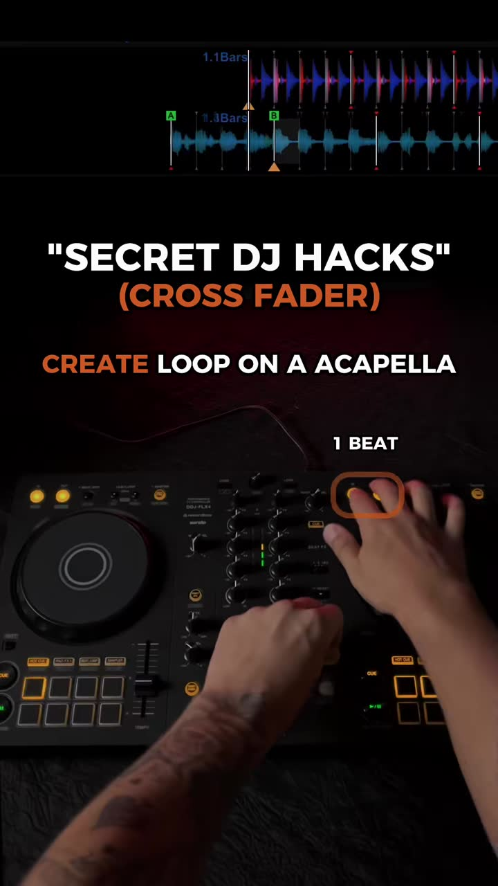
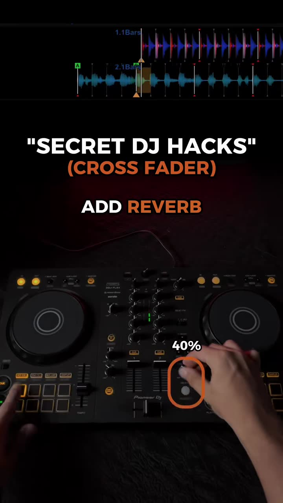
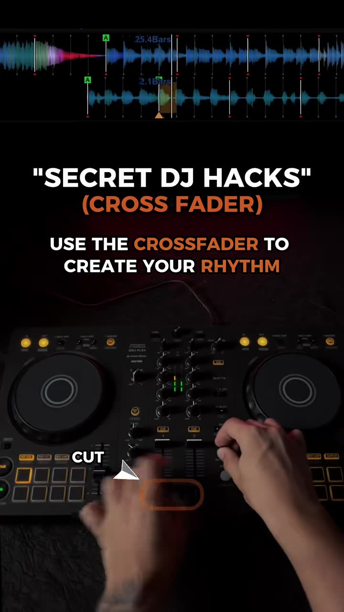
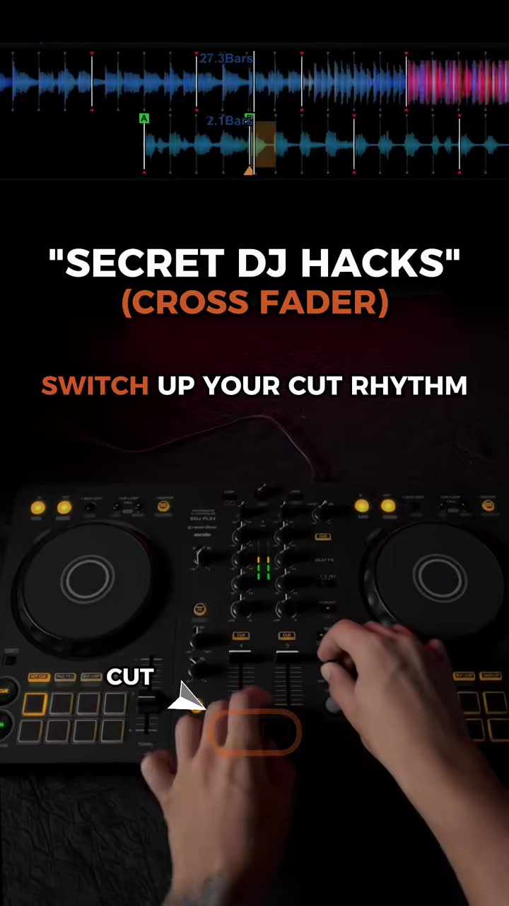
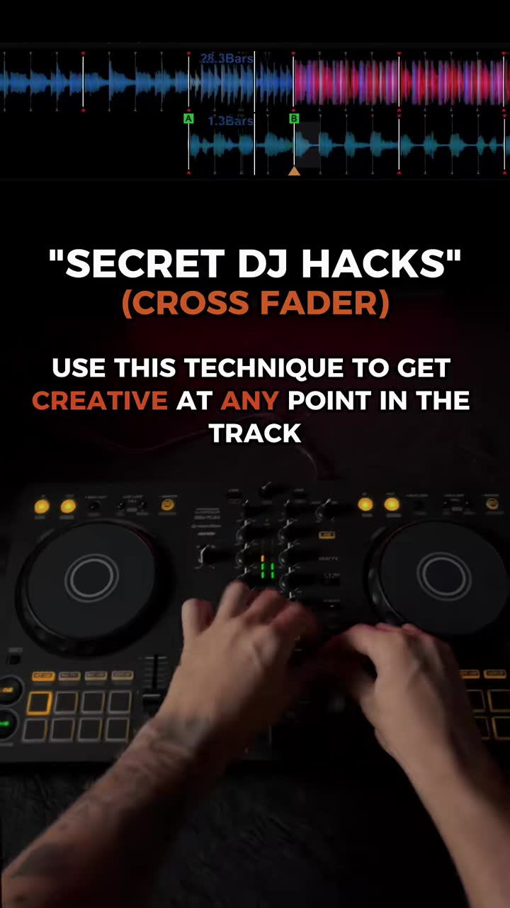

# Crossfader rhythm on a looped, reverbed acapella

| | |
|---|---|
| Source | <https://www.tiktok.com/@lilianbilottaa/video/7682170614508965128> |
| Creator | lilianbilottaa (@lilianbilottaa) |
| Uploaded | 2026-09-05 |
| Duration | 12s |
| Hashtags | #dj #djtips #foryou #djtransition #djing |
| Audio | son original |
| Ingested | 2026-10-30 by yeung-assistant (yt-dlp + faster-whisper `small`, language `en`) |

**Caption (verbatim):**

> The crossfader isn’t just for switching between tracks 🔥 Use it to create your own rhythm and add movement to your transitions. It’s a simple technique that can make your mixes way more creative! I post new DJ techniques, transitions & tutorials every single day to help you improve faster and get more creative behind the decks. 🚀 🎓 Want personalized DJ coaching? Comment “DJ” and I’ll send you a message  #dj #djtips #foryou #djtransition #djing

## Summary

A 12-second "secret DJ hack". Set a 1-beat loop on an acapella ("Everybody dance now"), add reverb (about 40% on the FX knob), then use the crossfader cut to tap your own rhythm with the vocal, and vary the cut rhythm. The caption says the crossfader isn't just for switching tracks: it can add movement and rhythm inside a transition, at any point in the track.

## Key takeaways

- Step 1: create a 1-beat loop on an acapella phrase.
- Step 2: add reverb (the FX knob is shown at about 40%) so the chopped stabs have a tail and don't sound clipped.
- Step 3: use the crossfader cut to play the loop rhythmically over the other deck.
- Step 4: switch up the cut rhythm (vary the pattern rather than repeating one).
- Use it creatively at any point in the track, not only at the hand-off. It adds movement to transitions.

## Verbatim phrases and script

Audio is the looped acapella hook ("Everybody dance now ... da da da"); there is no spoken instruction. The steps are on-screen text only.
> Caption: "The crossfader isn't just for switching between tracks. Use it to create your own rhythm and add movement to your transitions. It's a simple technique that can make your mixes way more creative!"

## On-screen text

Read from the frames by eye, because tesseract OCR could not be installed on the ingest box. `[...]` marks text that was hidden or is uncertain.

- "SECRET DJ HACKS" / "(CROSS FADER)"
- "CREATE LOOP ON A ACAPELLA" (pad highlighted: "1 BEAT")
- "ADD REVERB" (FX knob at "40%")
- "USE THE CROSSFADER TO CREATE YOUR RHYTHM" ("CUT" arrow on the crossfader)
- "SWITCH UP YOUR CUT RHYTHM"
- "USE THIS TECHNIQUE TO GET CREATIVE AT ANY POINT IN THE TRACK"

## Screenshots

Frames were chosen where a new tip, list item, or on-screen demo starts, using the transcript, ffmpeg scene-change detection, and manual review. They are 720px wide JPGs.

**0:01.5**: "Secret DJ hacks (cross fader)": step 1, create a 1-beat loop on an acapella

**0:03.5**: Step 2: add reverb (effect knob at about 40%)

**0:05.5**: Step 3: use the crossfader to create your own rhythm (cut)

**0:08.5**: Step 4: switch up your cut rhythm

**0:10.5**: "Use this technique to get creative at any point in the track"

## How to apply

- **Closest existing move:** `transformer_cut` (rapid crossfader chops; see the crossfader-cut section of `docs/DJ_TRANSITIONS_PLAYBOOK.md`). This video adds two ingredients we don't use yet: the cut source is a **1-beat loop** (`beatloop_1_activate`, ideally under `slip_enabled` so the track position snaps back), and a **reverb wash** on that deck so each cut has a tail.
- **Candidate flourish, `loop_chop_rhythm`:** on an acapella or vocal-heavy deck, set a 1-beat loop on a hook word, enable a quantized Reverb (Mixxx has Reverb in the effects framework; reserve an effect slot the way Echo is reserved), and drive crossfader cuts on a rhythm pattern (for example 16ths for 1 bar, then a syncopated pattern for the next) from the deterministic `hands/` engine, not the screenshot agent.
- **Phrasing:** run it for 1-2 bars right before a phrase boundary, then release the loop (slip snaps back on-grid) and continue the blend.
- **Guardrails:** this is a showcase flourish. Keep it under the `flourish_every` rotation and the `no_flourish` directive, and never use it to end a song abruptly (see the never-end-with-an-abrupt-cut-off user story). Release the reverb tail under a continuing track.

## Transcript

Full timestamped transcript: [transcript.md](transcript.md).
