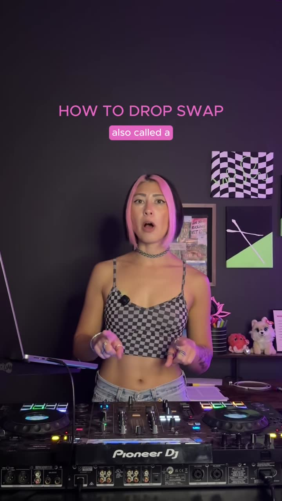
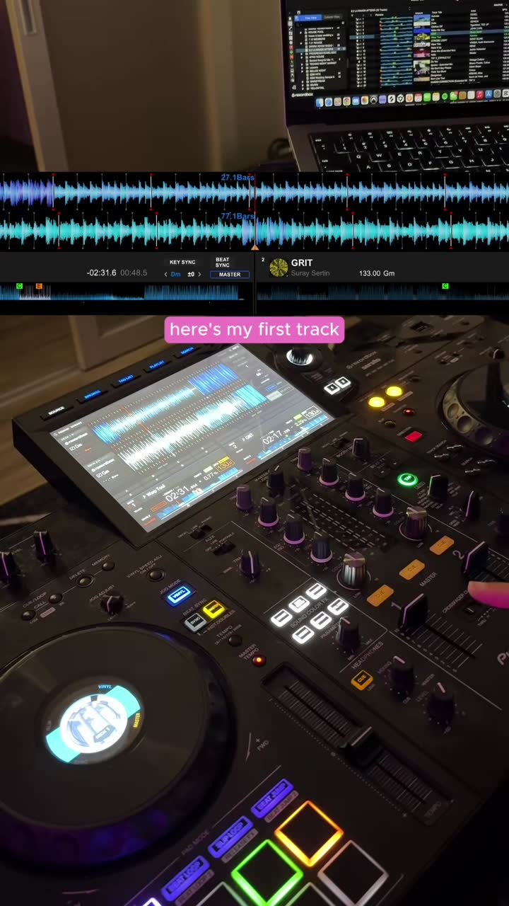
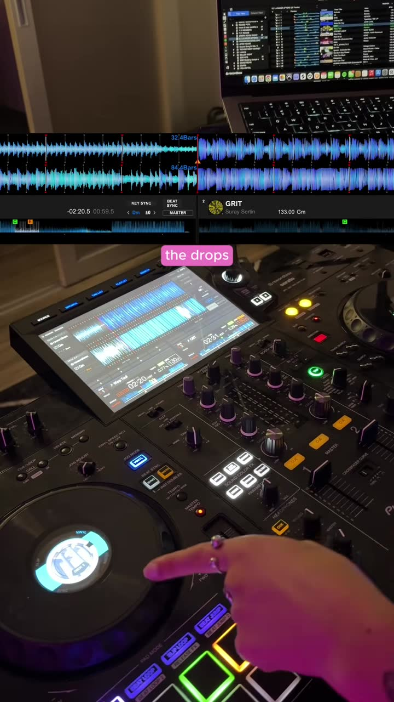
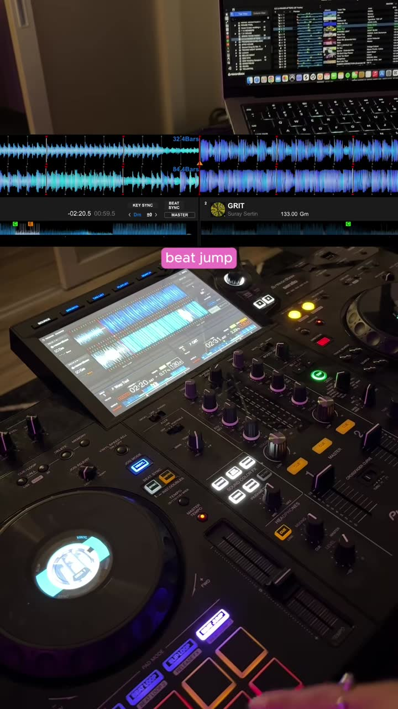
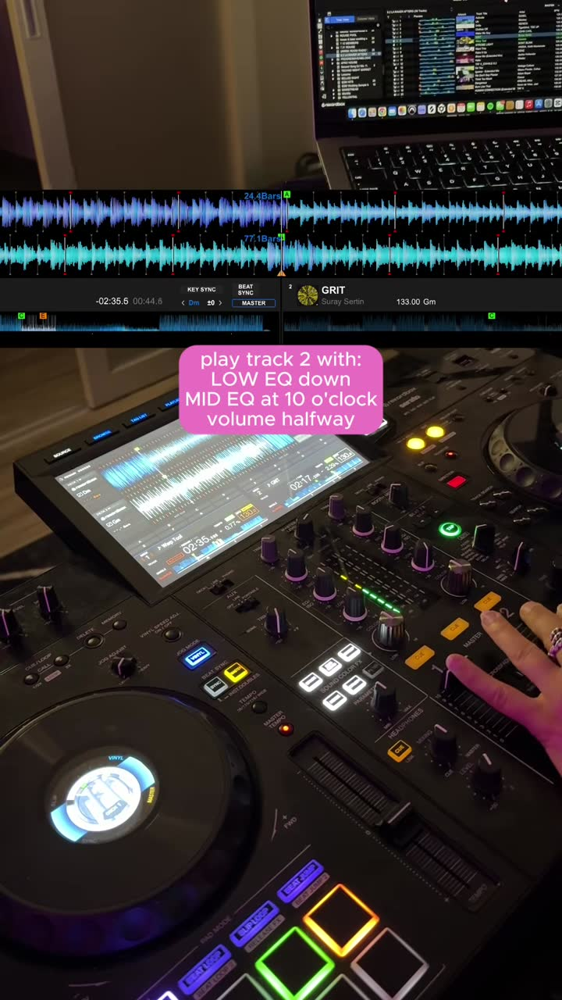
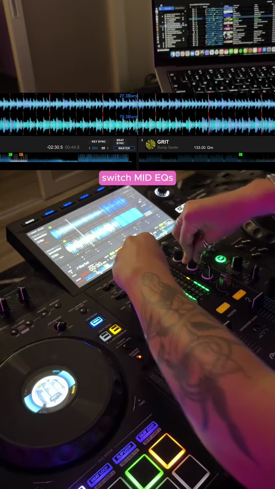
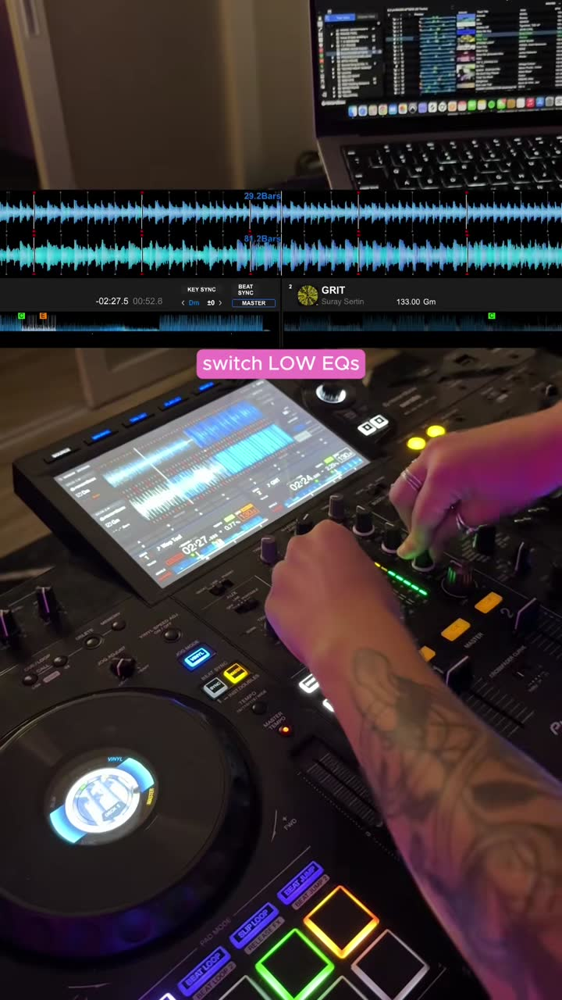
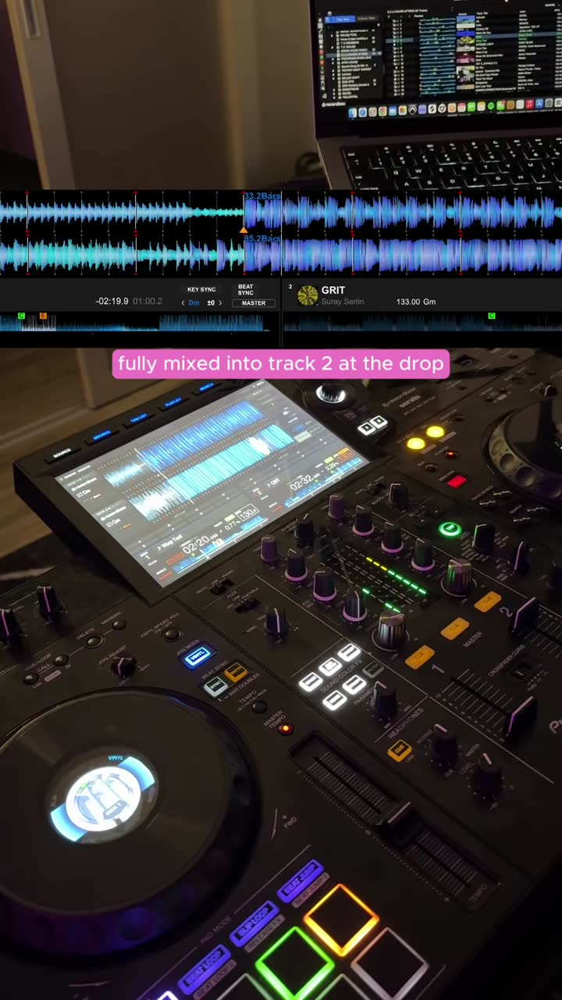

# Drop swap (drop switch): mix in during the build, land on the new track's drop

| | |
|---|---|
| Source | <https://www.tiktok.com/@tayxsounds/video/7701063954830839053> |
| Creator | tayxsounds (@tayxsounds) |
| Uploaded | 2026-10-26 |
| Duration | 73s |
| Hashtags | #beginnerdj #djtutorial #djtips #howtodj |
| Audio | original sound |
| Ingested | 2026-10-30 by yeung-assistant (yt-dlp + faster-whisper `small`, language `en`) |

**Caption (verbatim):**

> Drop swapping creates a fresh moment by flipping into the drop of a new track - love using this in my sets!  #beginnerdj #djtutorial #djtips #howtodj

## Summary

tayxsounds explains a drop swap, also called a drop switch. You mix the new track in while the current track is building, then switch into the new track's drop at the moment the current track's drop would hit. Line up both drops, find the start point by counting back bar by bar (or with beat jump), bring track 2 in with LOW EQ down, MID EQ at 10 o'clock, and the volume halfway. Raise the volume, switch the MID EQs, switch the LOW EQs, pull track 1 down, and you are fully in track 2 at the drop.

## Key takeaways

- A drop swap replaces the current track's drop with the next track's drop, timed to the exact moment the crowd expects the first drop.
- Align drop to drop: the incoming track's drop has to coincide with the outgoing track's drop point.
- Find the incoming start point by counting backward bar by bar from the drop, or by flipping the deck into beat jump and stepping back in equal increments.
- Start track 2 with LOW EQ fully down, MID EQ at about 10 o'clock (partly cut), and the channel volume halfway.
- During the build, bring the volume up, then switch the MID EQs, then switch the LOW EQs (bass last), then volume down on track 1.
- Result: fully mixed into track 2 at the drop. Both decks are at the same BPM (133 on screen).

## Verbatim phrases and script

> "A drop swap, also called a drop switch, is a transition where you are mixing in a new track while your current track is building, and you are switching into the drop of the new track at the time that the drop of your current track is supposed to hit."
>
> "Instead of hitting the drop of this track, we are going to switch it into the drop of my next."
>
> "First, I'm going to line up the drops of both of these tracks, and to find out where in my current track I need to start my next one, I can either count backwards bar by bar, or flip my deck into beat jump and go backwards in equal increments, and right there is where I'm going to start my next track."

## On-screen text

Read from the frames by eye, because tesseract OCR could not be installed on the ingest box. `[...]` marks text that was hidden or is uncertain.

- "HOW TO DROP SWAP" with word-by-word captions
- "here's my first track" / "line up" / "the drops" / "of both of these tracks" / "count backwards" / "bar by bar" / "flip my deck into" / "beat jump"
- "play track 2 with: LOW EQ down / MID EQ at 10 o'clock / volume halfway"
- "start to bring volume up"
- "switch MID EQs"
- "switch LOW EQs"
- "volume down on track 1"
- "fully mixed into track 2 at the drop"
- Deck displays show both tracks at 133.00 BPM

## Screenshots

Frames were chosen where a new tip, list item, or on-screen demo starts, using the transcript, ffmpeg scene-change detection, and manual review. They are 720px wide JPGs.

**0:01.0**: "How to drop swap": definition delivered to camera

**0:13.5**: Track 1 playing on the controller (both decks at 133 BPM on screen)

**0:37.0**: Lining up the drops of both tracks

**0:46.5**: Using beat jump to step backwards in equal increments to find the start point

**0:54.5**: "Play track 2 with: LOW EQ down, MID EQ at 10 o'clock, volume halfway"

**0:59.5**: "Switch MID EQs"

**1:02.5**: "Switch LOW EQs"

**1:10.0**: "Fully mixed into track 2 at the drop"

## How to apply

- **This is the "drop-to-drop" variant** that `docs/DJ_TRANSITIONS_PLAYBOOK.md` (Drop mix section and scorecard) lists as a gap, but done as a blend under the build rather than a hard cut. Proposed technique name: `drop_swap`.
- **Planning math (brain):** given the outgoing drop time `D_out` and the incoming drop time `D_in` (from phrase/energy analysis), with the BPMs matched (`sync`/`set_bpm_target`), cue the incoming at `D_in - N*beats_per_bar` and press play at `D_out - N*beats_per_bar`, with N = the build length in bars (typically 8 or 16, a phrase multiple). This is the "count backwards bar by bar / beat jump in equal increments" step. `beatjump_N_backward` can do it live.
- **Execution timeline (hands), relative to the drop at t=0:**
  1. t = -N bars: incoming plays with the LOW EQ killed, MID about 10 o'clock (about -6 to -9 dB), volume about 50%.
  2. Over the build: ramp the incoming volume up to 100%.
  3. About 4 bars before: **swap MIDs** (outgoing mid down, incoming mid up).
  4. About 1 bar before, or exactly at the drop: **swap LOWs**. This is a gradual-ish bass swap, consistent with the playbook's note to make `bass_swap` a ramp.
  5. At the drop: outgoing volume down. The incoming drop carries the energy.
- **Why it fits claw-dj:** it keeps both tracks present (no abrupt cut-off, which respects the never-end-a-song-with-an-abrupt-cut-off story) and lands on maximum energy. It needs phrase-accurate drop detection and a tight beat grid, so validate with `transition preview` and dry runs before live use.
- **Genre note:** the demo is EDM (133 BPM). For hip-hop/R&B, the same logic applies to hook-to-hook or verse-to-hook swaps (the incoming hook lands where the outgoing hook would).

## Transcript

Full timestamped transcript: [transcript.md](transcript.md).
