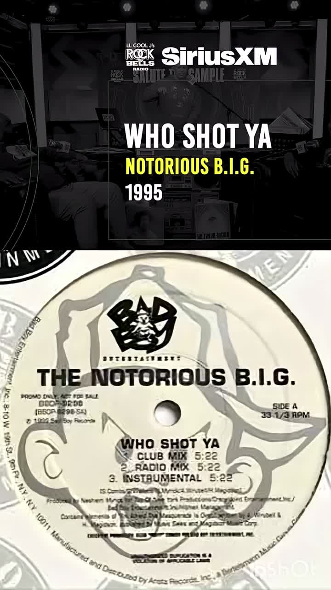
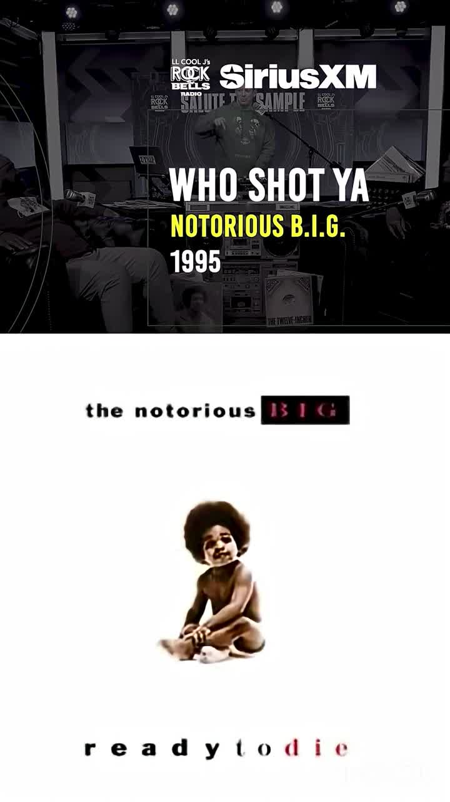
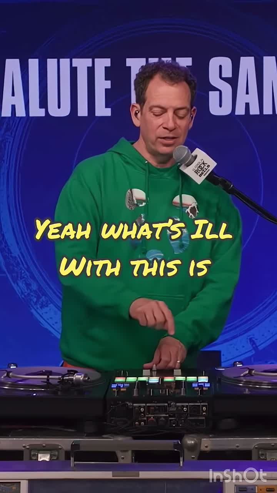

# "Did you catch it?" — Rock The Bells Radio sample breakdown of Who Shot Ya

| | |
|---|---|
| Source | <https://youtube.com/shorts/VmhaMrE1Gmc> |
| Canonical | <https://www.youtube.com/shorts/VmhaMrE1Gmc> · <https://www.youtube.com/watch?v=VmhaMrE1Gmc> |
| Creator | G90 (`@Shadyshortsfromstan`, channel [UC8HpzKzjdib4V6EKIBZPHsQ](https://www.youtube.com/channel/UC8HpzKzjdib4V6EKIBZPHsQ)) |
| Upload date | 2026-07-19 (America/Los_Angeles) |
| Duration | 60s |
| Stats (yt-dlp) | 1,015,827 views · 28,895 likes · 617 comments |
| Ingested | 2026-11-05 by yeung-assistant (yt-dlp + faster-whisper `small`) |

## Source

LL Cool J's Rock The Bells Radio (SiriusXM) "Salute the Sample" segment. The
host reacts while a DJ blends between the sample and the sampler, revealing:

**The Notorious B.I.G. — Who Shot Ya (1995)** samples
**David Porter — "I'm Afraid The Masquerade Is Over"** (written by A. Wrubel
& H. Magidson).

The clip shows the Bad Boy promotional 12" label (`BBDP-9298`) listing:

- A1. Who Shot Ya? (Club Mix)
- A2. Who Shot Ya? (Radio Mix)
- B1. Who Shot Ya? (Instrumental)

A live DJ performs on Technics turntables with a Pioneer DJM-S series mixer.

## Related claw-dj documentation

- [`docs/WHO_SHOT_YA_LISTENING_REVIEW_2026-09-05.md`](../../../WHO_SHOT_YA_LISTENING_REVIEW_2026-09-05.md) —
  backbeat/skit listening review for the same track
- [`AGENTS.md`](../../../../AGENTS.md) — The Notorious B.I.G. "Who Shot Ya"
  first verse timing observation and mandatory recording boundary for the
  50 Cent version

## Key takeaways

1. **Sample identification:** The signature vocal phrase "I'm afraid the
   masquerade is over / And so is love" appears beneath the "Who Shot Ya"
   hook. The host points out that "the loop has her in the background."
2. **DJ demonstration:** The blend technique keeps the sample audible beneath
   the sampled track, then reveals the source record. This is the same
   source-to-sample lineage reveal pattern described in
   [`docs/ANTHOLOGY_AND_SHORT_FORM_PROGRAM.md`](../../../ANTHOLOGY_AND_SHORT_FORM_PROGRAM.md):
   making sample relationships audible through adjacency and transition design.
3. **Bad Boy promo label:** The `BBDP-9298` 12" includes Club, Radio, and
   Instrumental mixes. For claw-dj, the Instrumental can support vocal-only
   layering work documented in
   [`docs/FULL_MIX_INSTRUMENTAL_LAYERING.md`](../../../FULL_MIX_INSTRUMENTAL_LAYERING.md).
4. **Production note:** The loop retains Diana Ross's vocal phrase throughout
   the verses, not just in the hook. This continuous presence explains why the
   host says "she's in there" even during verse sections.

## Verbatim phrases

> "Cause I got something for you. Hold that. Hold that."

> "Yo, that's too crazy right there."

> "That's stupid right there."

> "You hear it? You know it."

> "Yeah, what's ill with this is the loop has her in the background."

> "She's in there."

The DJ and hosts react to the blend; the final section plays back the "Who
Shot Ya" hook over the revealed sample.

## Screenshots

Frames extracted at 5-second intervals from the 60-second short. All files are
720×1280 JFIF JPGs with no EXIF/GPS metadata (extracted via ffmpeg).

| Timestamp | Description | File |
|---|---|---|
| 0:01 | Opening — host preparing the segment | [t_1.jpg](screenshots/t_1.jpg) |
| 0:05 | DJ at Technics/Pioneer setup | [t_5.jpg](screenshots/t_5.jpg) |
| 0:10 | Host reaction ("too crazy") | [t_10.jpg](screenshots/t_10.jpg) |
| 0:15 | Blend in progress | [t_15.jpg](screenshots/t_15.jpg) |
| 0:20 | Host nodding along | [t_20.jpg](screenshots/t_20.jpg) |
| 0:25 | "You hear it" moment | [t_25.jpg](screenshots/t_25.jpg) |
| 0:30 | DJ working the decks | [t_30.jpg](screenshots/t_30.jpg) |
| 0:35 | "The loop has her in the background" | [t_35.jpg](screenshots/t_35.jpg) |
| 0:40 | Host listening | [t_40.jpg](screenshots/t_40.jpg) |
| 0:45 | **Bad Boy promo 12" label (BBDP-9298)** — key frame showing sample credit | [t_45.jpg](screenshots/t_45.jpg) |
| 0:50 | "Who Shot Ya / Ready to Die" info card | [t_50.jpg](screenshots/t_50.jpg) |
| 0:55 | Reveal continues | [t_55.jpg](screenshots/t_55.jpg) |
| 0:59 | Closing | [t_59.jpg](screenshots/t_59.jpg) |

### Key frames

**t_45.jpg** — Bad Boy promo vinyl label with sample credit:

**t_50.jpg** — "Who Shot Ya / Ready to Die" info card:

**t_30.jpg** — DJ at decks during the blend:

## How to apply

- **Sample-lineage reveal clips:** This "Salute the Sample" format is a model
  for short-form promo clips from claw-dj anthology work. The
  [`docs/ANTHOLOGY_AND_SHORT_FORM_PROGRAM.md`](../../../ANTHOLOGY_AND_SHORT_FORM_PROGRAM.md)
  clip-candidate list includes "a recognizable source record revealing the
  sampled record, or the reverse."
- **Instrumental layering:** When building a "Who Shot Ya" mix segment, the
  Instrumental from `BBDP-9298` (if available in the library) can reinforce the
  full mix while preserving backbeat alignment, per
  [`docs/FULL_MIX_INSTRUMENTAL_LAYERING.md`](../../../FULL_MIX_INSTRUMENTAL_LAYERING.md).
- **No implementation change:** This ingest is reference material. It does not
  change any behavior in `brain/` or `hands/`.

## Transcripts

- [transcript.md](transcript.md) — faster-whisper `small` transcription
- [transcript_auto.md](transcript_auto.md) — YouTube auto-generated captions

## Verification

- Screenshots are unedited 720×1280 JFIF JPGs (no EXIF/GPS metadata)
- No `.mp4` or `.tar.gz` archives committed
- All paths are relative within this repository
